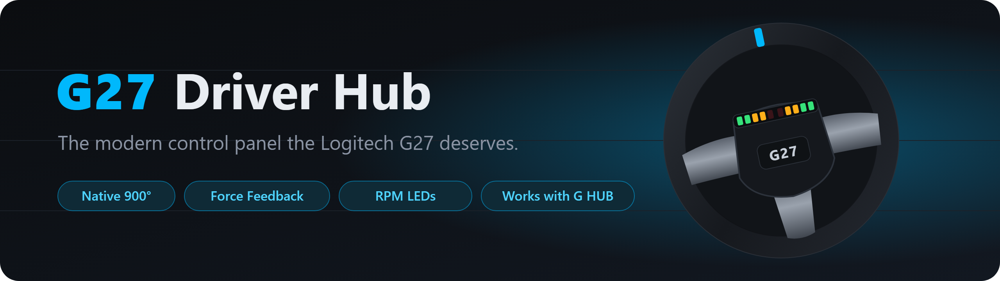
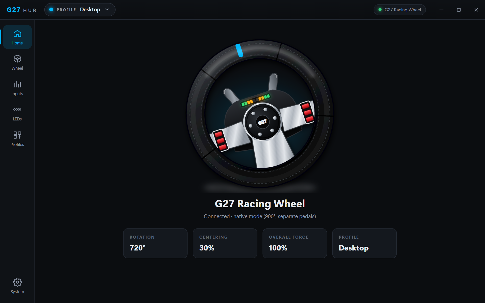
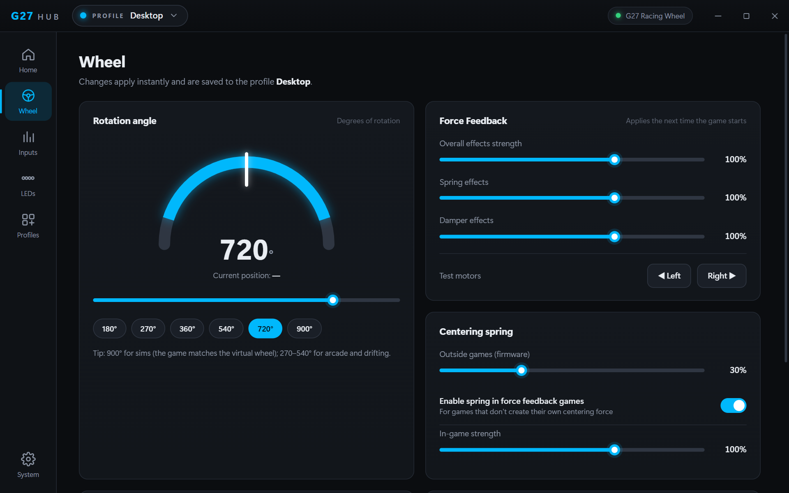
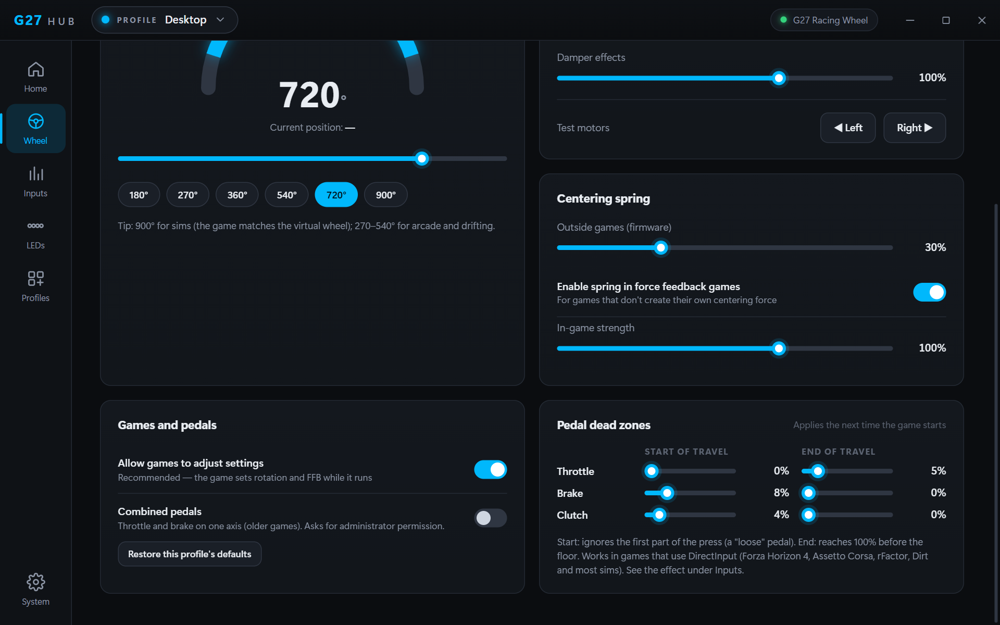
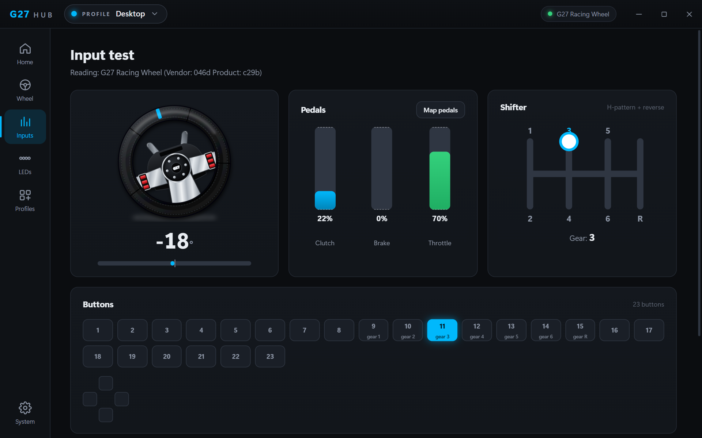
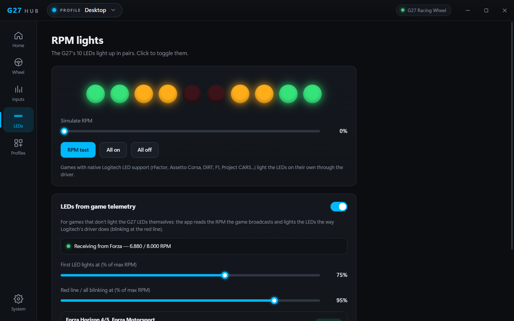
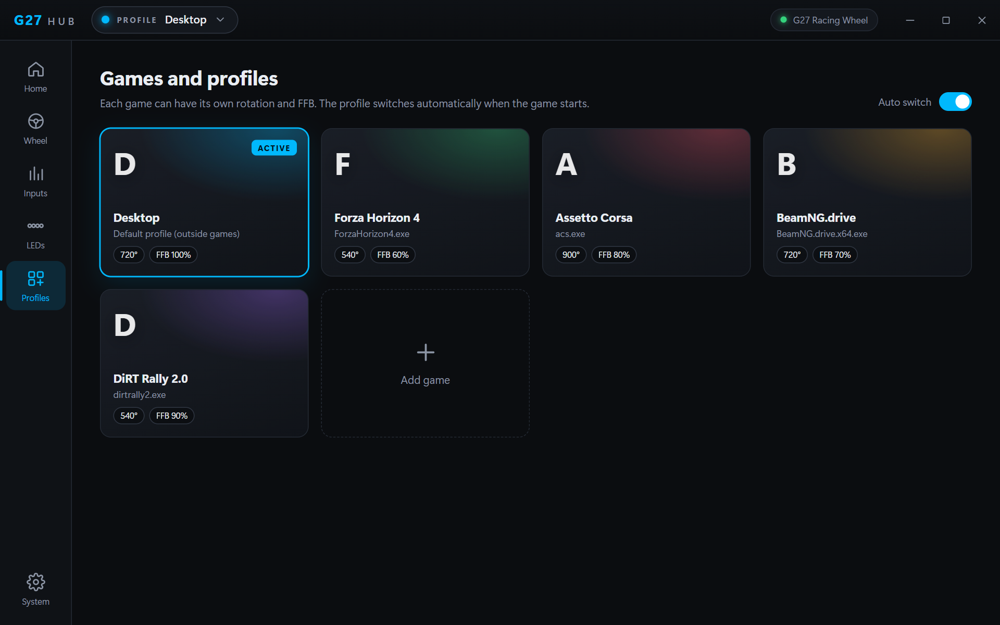
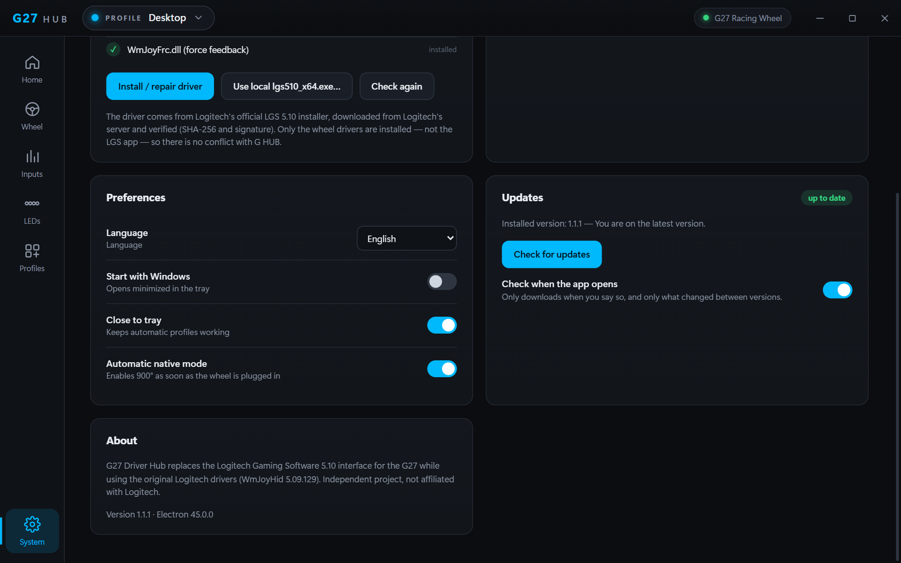

<p align="center">
  
</p>

<p align="center">
  <a href="https://github.com/VictorVLS/g27-driver-hub/releases/latest"></a>
  <a href="https://github.com/VictorVLS/g27-driver-hub/releases"></a>
  
  <a href="LICENSE"></a>
</p>

<p align="center">
  <a href="https://github.com/VictorVLS/g27-driver-hub/releases/latest"><b>⬇️ Download the latest version</b></a>
  &nbsp;·&nbsp; <a href="#-features">Features</a>
  &nbsp;·&nbsp; <a href="#-install">Install</a>
  &nbsp;·&nbsp; <a href="#-rpm-leds-in-games">LEDs in games</a>
  &nbsp;·&nbsp; <a href="#-faq">FAQ</a>
  &nbsp;·&nbsp; <a href="README.md">🇧🇷 Português</a>
</p>

---

G HUB does not support the **Logitech G27**, and the old software (Logitech Gaming Software 5.10, from 2010) has a dated interface and conflicts with G HUB. **G27 Driver Hub** installs only the original wheel drivers and gives you a modern, G HUB-style control panel, in English and Portuguese.

<p align="center">
  
</p>

## ✅ What it fixes

| Problem | Now |
|---|---|
| Wheel with **"code 39"** or **no force feedback** after uninstalling or updating LGS | One click on **Install / repair driver** reinstalls everything |
| **Conflict with G HUB** (LGS runs `LCore.exe`, and G HUB shuts LGS down) | Installs **only the wheel drivers**: G HUB and G27 Driver Hub run side by side |
| Wheel stuck at **200°** with combined pedals | Switches to **native mode** automatically (900°, separate pedals, shifter and LEDs) and powers up at 900° even without the app |
| Auto-centering that stops **far from centre** | Spring recalibrated from measurements on the wheel: stops 2–5° from centre |
| Dated, confusing interface | Everything applies instantly, no "Apply" button |

## 🖼️ Screens

<table>
  <tr>
    <td width="50%"><br><b>Wheel</b>: rotation with the real position, force feedback and centering</td>
    <td width="50%"><br><b>Pedal dead zones</b>: start and end of travel for each pedal</td>
  </tr>
  <tr>
    <td><br><b>Inputs</b>: wheel, pedals, H-shifter and buttons live</td>
    <td><br><b>RPM LEDs</b>: lit from Forza telemetry</td>
  </tr>
  <tr>
    <td><br><b>Per-game profiles</b>: switch automatically when the game starts</td>
    <td><br><b>System</b>: driver, preferences and updates</td>
  </tr>
</table>

## 🎮 Features

| | |
|---|---|
| **Rotation** | 40° to 900°, with presets (180/270/360/540/720/900) and a live wheel position |
| **Force feedback** | Overall, spring and damper strength (0–150%), in-game centering spring and a motor test |
| **Centering** | Firmware spring outside games, adjustable or off |
| **Pedal dead zones** | Start and end of travel for throttle, brake and clutch (0–40%) |
| **Per-game profiles** | Own rotation, FFB and dead zones; switch automatically when the game starts |
| **Input test** | Wheel, pedals, shifter with the engaged gear, buttons and D-pad; pedal mapping |
| **RPM LEDs** | Manual control, simulator and LEDs from game telemetry |
| **Combined pedals** | For old games that only accept throttle and brake on one axis |
| **Driver** | Full diagnostics and one-click repair |
| **Updates** | From inside the app, downloading only what changed (≈1 MB instead of 110 MB) |
| **Tray and languages** | Starts with Windows, runs in the tray; English and Portuguese |

## 📥 Install

1. Download **`G27-Driver-Hub-Setup-x.y.z.exe`** from the [releases page](https://github.com/VictorVLS/g27-driver-hub/releases/latest).
2. Run the installer and accept the Windows administrator prompt (needed to install a driver).
3. The installer downloads the **official LGS 5.10 package straight from Logitech's server**, verifies its SHA-256 and Logitech's digital signature, and installs **only the wheel drivers**.
4. Open **G27 Driver Hub** and plug in the wheel.

> [!NOTE]
> Windows may show a **SmartScreen** warning because the installer is not code-signed. Click **More info → Run anyway**.

<details>
<summary><b>No internet?</b></summary>

Install the app and use **System → Use local lgs510_x64.exe…** with a copy of `lgs510_x64.exe` (SHA-256 `e07a278e…ca76`).
</details>

<details>
<summary><b>Updates</b></summary>

Since 1.1.0 the app tells you when a new version is out and updates from **System → Updates**, downloading only the parts that changed. A healthy driver is not reinstalled during an update, so the wheel is not restarted. On 1.0.x, install the new version manually once.
</details>

**Requirements:** 64-bit Windows 10 or 11 and a Logitech G27. The G25, DFGT and DFP are recognised but not tested yet.

## 💡 RPM LEDs in games

**Games with native Logitech LED support** (rFactor, Assetto Corsa, DiRT, F1, Project CARS…) light the LEDs on their own. The command goes from the game straight to Logitech's driver, with no LGS and no app needed.

**For other games**, the app reads the telemetry and lights the LEDs with the same pattern as Logitech's driver (5 steps, all blinking at the red line). Enable telemetry in the game, pointing at **`127.0.0.1`**:

| Game | Where | Port |
|---|---|---|
| **Forza Horizon 4/5, Forza Motorsport** | Settings → HUD and Gameplay → **Data Out** | `5300` |
| **BeamNG.drive, Live for Speed** | Options → **OutGauge** | `4444` |
| **DiRT Rally/2.0, DiRT 4, GRID** | `hardware_settings_config.xml` → `udp enabled="true" extradata="3"` | `20777` |

If another tool (SimHub, for example) already uses the port, the **LEDs** screen shows "port in use".

## 🔧 Tips

- **FFB strength:** the game's force feedback scale and the app's "overall strength" multiply. Set the game first. Real example: Forza Horizon 4's scale was at 4%, and the wheel felt like it had no FFB.
- **FFB and dead-zone changes apply the next time the game starts.** Rotation and centering change instantly.
- **"Loose" pedal** (stays at 1–3% after release): check under **Inputs** whether the bar returns to 0%. If not, set **Dead zones → Start of travel** to 3–5%.

## ❓ FAQ

<details>
<summary><b>Can G HUB recognise the G27?</b></summary>

Not reliably. G HUB's device database only lists the G29, G920 and G923, and its wheel features go through its own driver, which does not exist for the G27. That is why G27 Driver Hub runs **alongside** G HUB.
</details>

<details>
<summary><b>Does the app ship Logitech files?</b></summary>

No. The LGS licence forbids redistribution, so this repository and its installers contain no Logitech files. The driver is downloaded from Logitech's own server, on your PC.
</details>

<details>
<summary><b>Does the app need to stay open?</b></summary>

Only for automatic profiles, the centering spring outside games and the telemetry LEDs. Force feedback and pedal dead zones work through the driver even with the app closed.
</details>

<details>
<summary><b>Can I have a dead zone at the wheel's centre?</b></summary>

Not this way: neither the G27 firmware nor Logitech's driver offer one. Use the game's own dead-zone setting.
</details>

## 🛠️ For developers

```bash
npm install
npm start        # run from source
npm run dist     # build the installer into dist/
```

Requires Node.js 22 or 24. How the app talks to the wheel and the driver (HID commands, registry values, DirectInput calibration, telemetry and updates) is documented in [docs/TECHNICAL.md](docs/TECHNICAL.md).

## ⚖️ Disclaimer

Independent project, **not affiliated with Logitech**. Logitech, G27 and G HUB are Logitech trademarks. The installed drivers are Logitech software, downloaded from Logitech's servers under Logitech's licence. The source code in this repository is [MIT licensed](LICENSE); third-party components are listed in [NOTICE.md](NOTICE.md). Use at your own risk.
