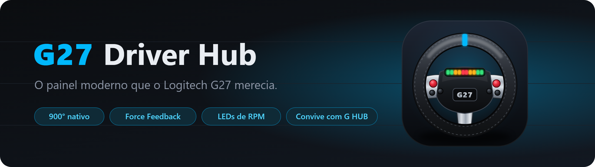
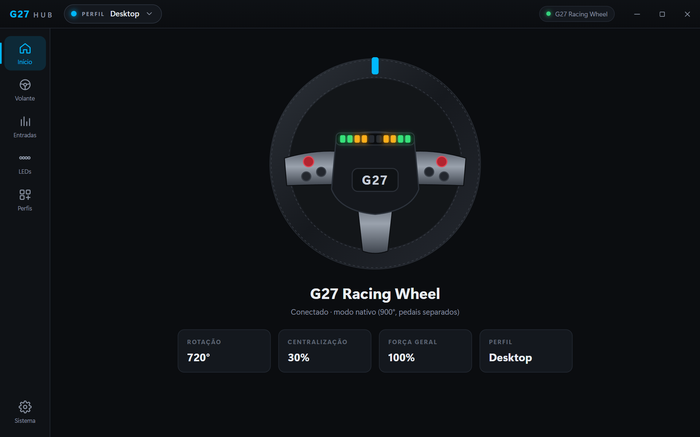
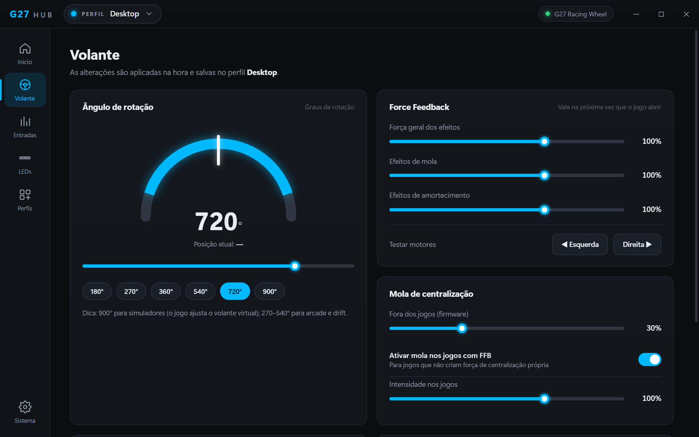
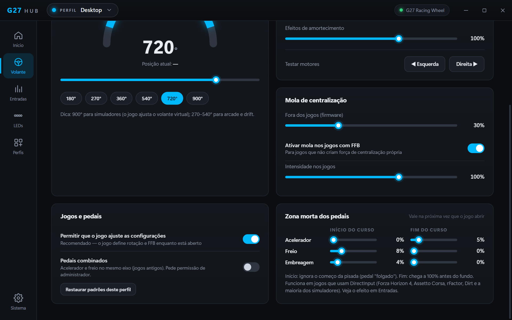
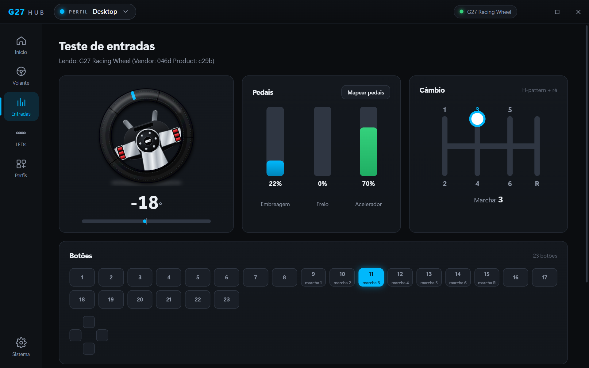
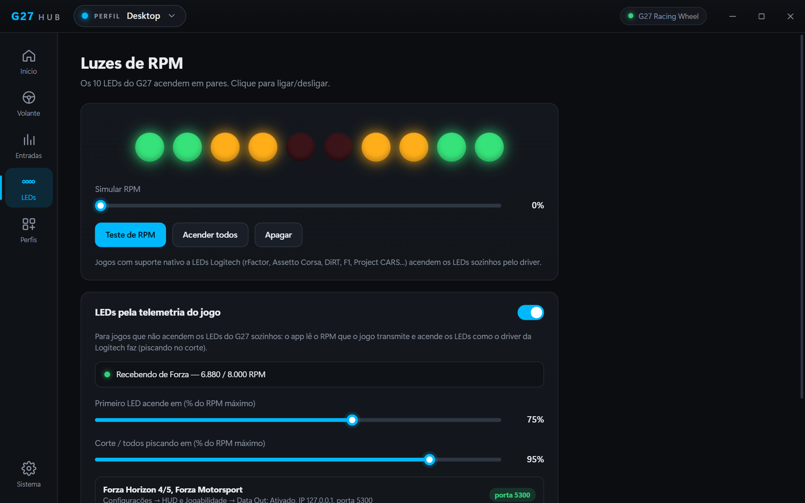
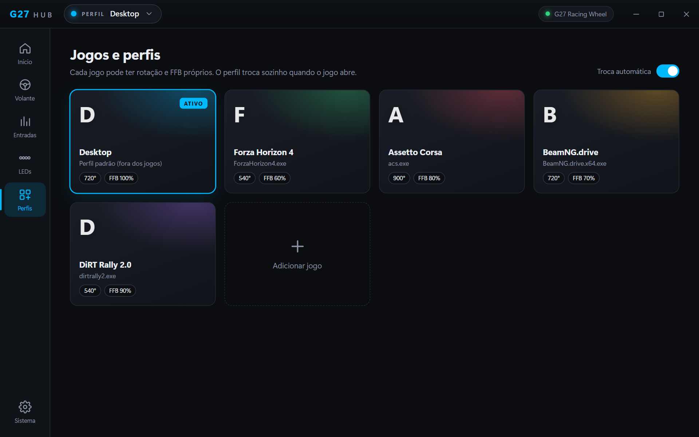
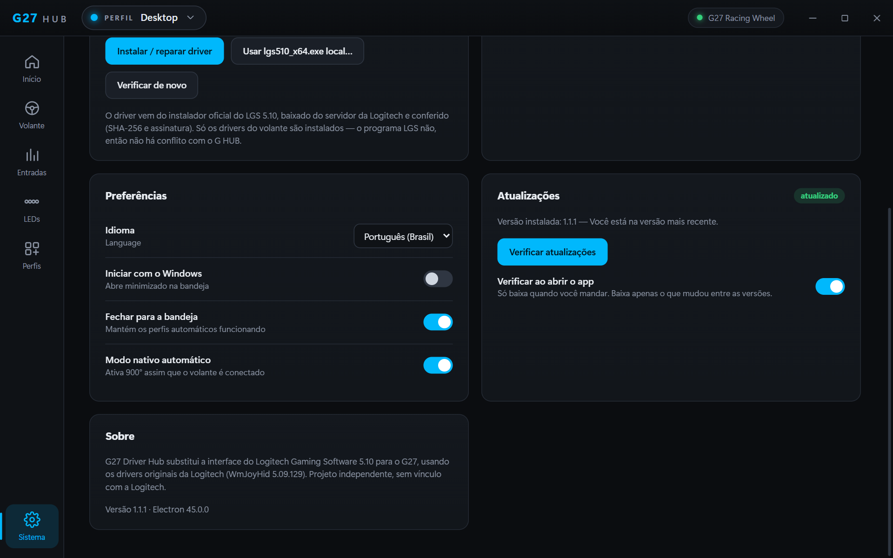

<p align="center">
  
</p>

<p align="center">
  <a href="https://github.com/VictorVLS/g27-driver-hub/releases/latest"></a>
  <a href="https://github.com/VictorVLS/g27-driver-hub/releases"></a>
  
  <a href="LICENSE"></a>
</p>

<p align="center">
  <a href="https://github.com/VictorVLS/g27-driver-hub/releases/latest"><b>⬇️ Baixar a versão mais recente</b></a>
  &nbsp;·&nbsp; <a href="#-recursos">Recursos</a>
  &nbsp;·&nbsp; <a href="#-instalação">Instalação</a>
  &nbsp;·&nbsp; <a href="#-leds-de-rpm-nos-jogos">LEDs nos jogos</a>
  &nbsp;·&nbsp; <a href="#-perguntas-frequentes">Perguntas</a>
  &nbsp;·&nbsp; <a href="README.en.md">🇺🇸 English</a>
</p>

---

O **Logitech G27** não é suportado pelo G HUB, e o software antigo (Logitech Gaming Software 5.10, de 2010) tem uma interface ultrapassada e briga com o G HUB. O **G27 Driver Hub** instala só os drivers originais do volante e entrega um painel moderno, no estilo do G HUB, em português e inglês.

<p align="center">
  
</p>

## ✅ O que ele resolve

| Problema | Como fica |
|---|---|
| Volante com **erro "código 39"** ou **sem Force Feedback** depois de desinstalar ou atualizar o LGS | Um clique em **Instalar / reparar driver** reinstala tudo |
| **Conflito com o G HUB** (o LGS roda o `LCore.exe`, e o G HUB fecha o LGS) | Instala **só os drivers do volante**: G HUB e G27 Driver Hub rodam juntos |
| Volante preso em **200°** e pedais combinados | Ativa o **modo nativo** sozinho (900°, pedais separados, câmbio e LEDs) e liga em 900° mesmo sem o app aberto |
| Centralização que para **longe do centro** | Mola recalibrada com medições no volante: para a 2–5° do centro |
| Interface velha e confusa | Tudo aplicado na hora, sem botão "Aplicar" |

## 🖼️ Telas

<table>
  <tr>
    <td width="50%"><br><b>Volante</b>: rotação com a posição real, Force Feedback e centralização</td>
    <td width="50%"><br><b>Zona morta dos pedais</b>: início e fim do curso de cada pedal</td>
  </tr>
  <tr>
    <td><br><b>Entradas</b>: volante, pedais, câmbio H e botões ao vivo</td>
    <td><br><b>LEDs de RPM</b>: acesos pela telemetria do Forza</td>
  </tr>
  <tr>
    <td><br><b>Perfis por jogo</b>: trocam sozinhos quando o jogo abre</td>
    <td><br><b>Sistema</b>: driver, preferências e atualizações</td>
  </tr>
</table>

## 🎮 Recursos

| | |
|---|---|
| **Rotação** | 40° a 900°, com atalhos (180/270/360/540/720/900) e a posição do volante ao vivo |
| **Force Feedback** | Força geral, mola e amortecimento (0–150%), mola nos jogos e teste dos motores |
| **Centralização** | Mola do firmware fora dos jogos, ajustável ou desligada |
| **Zona morta dos pedais** | Início e fim do curso de acelerador, freio e embreagem (0–40%) |
| **Perfis por jogo** | Rotação, FFB e zona morta próprios; troca automática quando o jogo abre |
| **Teste de entradas** | Volante, pedais, câmbio com a marcha engatada, botões e D-pad; mapeamento de pedais |
| **LEDs de RPM** | Controle manual, simulador e LEDs pela telemetria dos jogos |
| **Pedais combinados** | Para jogos antigos que só aceitam acelerador e freio no mesmo eixo |
| **Driver** | Diagnóstico completo e reparo com um clique |
| **Atualizações** | Pelo próprio app, baixando só o que mudou (≈1 MB em vez de 110 MB) |
| **Bandeja e idiomas** | Inicia com o Windows, roda na bandeja; português e inglês |

## 📥 Instalação

1. Baixe o **`G27-Driver-Hub-Setup-x.y.z.exe`** na [página de versões](https://github.com/VictorVLS/g27-driver-hub/releases/latest).
2. Rode o instalador e aceite o pedido de administrador do Windows (necessário para instalar driver).
3. O instalador baixa o **LGS 5.10 oficial direto do servidor da Logitech**, confere o SHA-256 e a assinatura digital da Logitech e instala **só os drivers do volante**.
4. Abra o **G27 Driver Hub** e conecte o volante.

> [!NOTE]
> O Windows pode mostrar o aviso do **SmartScreen**, porque o instalador não tem assinatura digital paga. Clique em **Mais informações → Executar assim mesmo**.

<details>
<summary><b>Sem internet?</b></summary>

Instale o app e use **Sistema → Usar lgs510_x64.exe local…**, apontando para uma cópia do instalador `lgs510_x64.exe` (SHA-256 `e07a278e…ca76`).
</details>

<details>
<summary><b>Atualizações</b></summary>

A partir da 1.1.0, o app avisa quando sai uma versão nova e atualiza em **Sistema → Atualizações**, baixando só as partes que mudaram. Numa atualização, o driver não é reinstalado se estiver saudável, então o volante não reinicia. Quem está na 1.0.x precisa instalar a versão nova manualmente uma vez.
</details>

**Requisitos:** Windows 10 ou 11 de 64 bits e um Logitech G27. O G25, o DFGT e o DFP são reconhecidos, mas ainda não foram testados.

## 💡 LEDs de RPM nos jogos

**Jogos com suporte nativo a LEDs Logitech** (rFactor, Assetto Corsa, DiRT, F1, Project CARS…) acendem os LEDs sozinhos. O comando vai do jogo direto para o driver da Logitech, sem precisar do LGS nem do app aberto.

**Para os outros jogos**, o app lê a telemetria e acende os LEDs com o mesmo padrão do driver da Logitech (5 etapas e todos piscando no corte). Ative a telemetria no jogo apontando para **`127.0.0.1`**:

| Jogo | Onde ativar | Porta |
|---|---|---|
| **Forza Horizon 4/5, Forza Motorsport** | Configurações → HUD e Jogabilidade → **Data Out** | `5300` |
| **BeamNG.drive, Live for Speed** | Opções → **OutGauge** | `4444` |
| **DiRT Rally/2.0, DiRT 4, GRID** | `hardware_settings_config.xml` → `udp enabled="true" extradata="3"` | `20777` |

Se outro programa (por exemplo, o SimHub) já usa a mesma porta, a tela **LEDs** mostra "porta em uso".

## 🔧 Dicas

- **Força do FFB:** a escala de Force Feedback do jogo e a "Força geral" do app se multiplicam. Ajuste primeiro no jogo. Exemplo real: no Forza Horizon 4 a escala estava em 4%, e o volante parecia sem FFB.
- **Mudanças de FFB e de zona morta valem na próxima vez que o jogo abrir.** A rotação e a centralização mudam na hora.
- **Pedal "folgado"** (fica em 1–3% depois de solto): veja em **Entradas** se a barra volta a 0%. Se não voltar, use **Zona morta → Início do curso** com 3–5%.

## ❓ Perguntas frequentes

<details>
<summary><b>Dá para o G HUB reconhecer o G27?</b></summary>

Não de forma confiável. O banco de dispositivos do G HUB só tem G29, G920 e G923, e os recursos de volante dele passam por um driver próprio que não existe para o G27. Por isso o G27 Driver Hub roda **ao lado** do G HUB.
</details>

<details>
<summary><b>O app inclui arquivos da Logitech?</b></summary>

Não. A licença do LGS proíbe redistribuição, então este repositório e os instaladores não têm nenhum arquivo da Logitech. O driver é baixado do servidor da própria Logitech, no seu PC.
</details>

<details>
<summary><b>Preciso deixar o app aberto?</b></summary>

Só para os perfis automáticos, a mola fora dos jogos e os LEDs pela telemetria. O Force Feedback e a zona morta dos pedais funcionam com o driver, mesmo com o app fechado.
</details>

<details>
<summary><b>Dá para ter zona morta no centro do volante?</b></summary>

Não por este caminho: nem o firmware do G27 nem o driver da Logitech oferecem isso. Use a opção de zona morta do próprio jogo.
</details>

## 🛠️ Para desenvolvedores

```bash
npm install
npm start        # roda em modo de desenvolvimento
npm run dist     # gera o instalador em dist/
```

Requer Node.js 22 ou 24. Os detalhes de como o app fala com o volante e com o driver (comandos HID, registro, calibração do DirectInput, telemetria e atualizações) estão em [docs/TECHNICAL.md](docs/TECHNICAL.md).

## ⚖️ Aviso legal

Projeto independente, **sem vínculo com a Logitech**. Logitech, G27 e G HUB são marcas da Logitech. Os drivers instalados são software da Logitech, baixados dos servidores da Logitech e regidos pela licença dela. O código deste repositório é distribuído sob a [licença MIT](LICENSE); componentes de terceiros estão em [NOTICE.md](NOTICE.md). Use por sua conta e risco.
