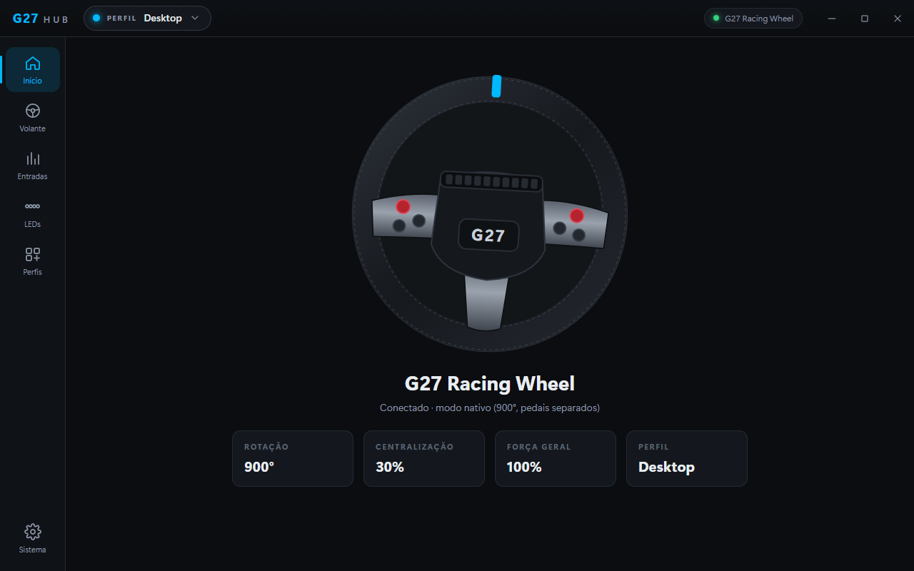
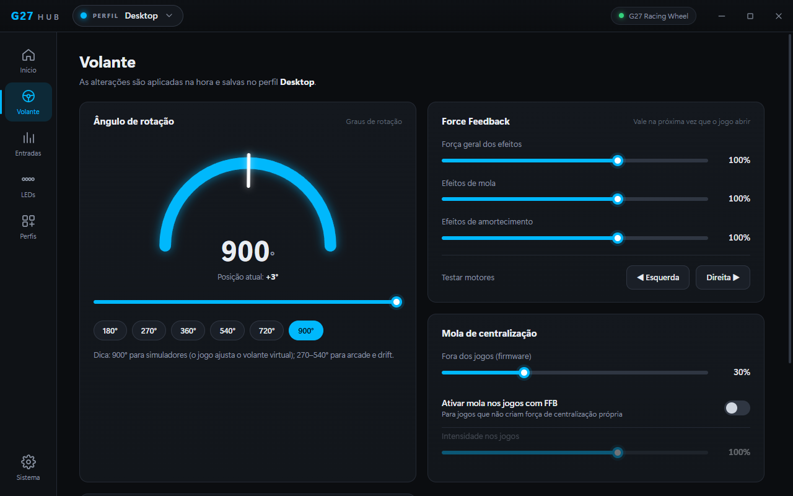
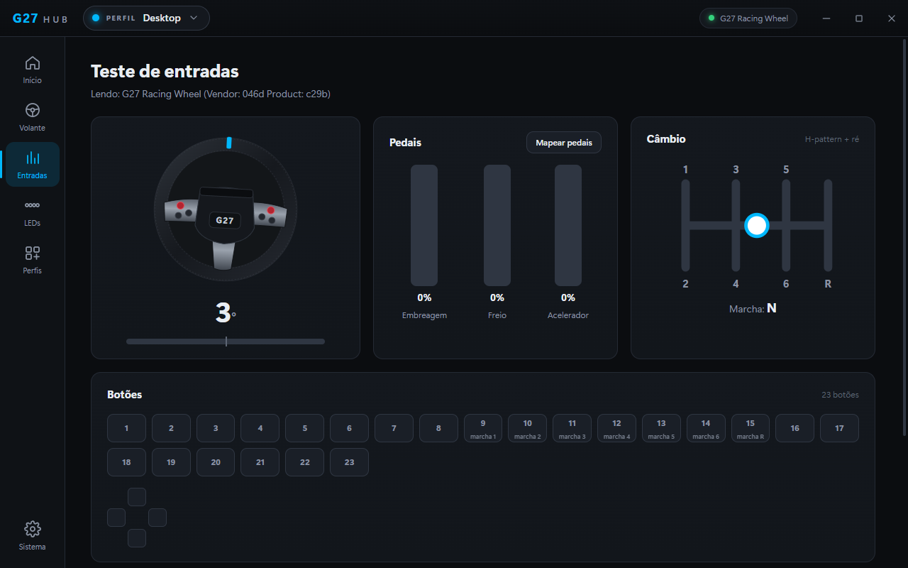
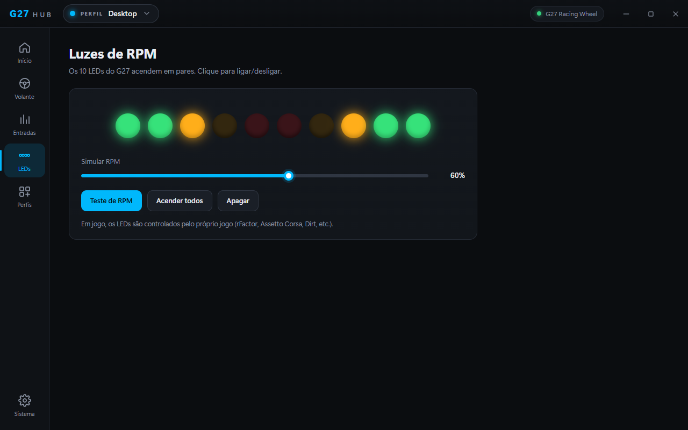
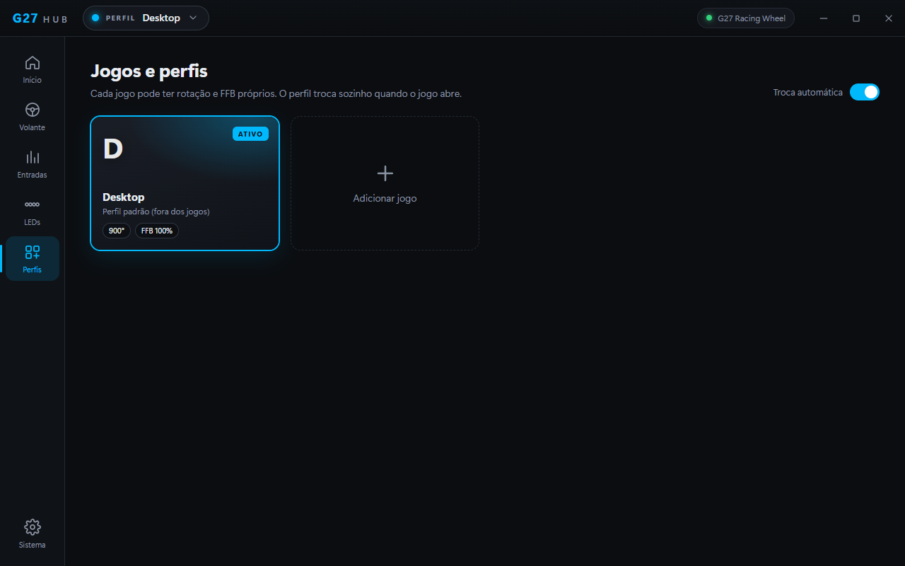
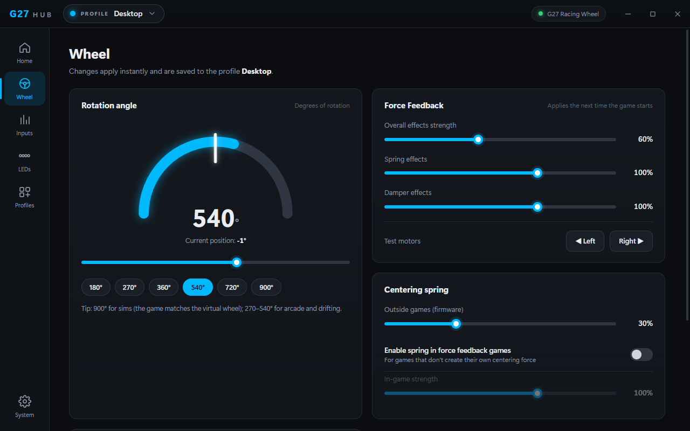

# G27 Driver Hub

**Painel moderno, estilo G HUB, para o volante Logitech G27 — com instalação e reparo automático do driver.**
*A modern, G HUB-style control panel for the Logitech G27 wheel, with automatic driver install and repair. [English below](#english).*



O Logitech G27 não é suportado pelo G HUB, e o software antigo (Logitech Gaming Software 5.10) é de 2010, tem uma interface ultrapassada e briga com o G HUB. O G27 Driver Hub resolve isso: instala só os drivers originais do volante e entrega uma interface nova, em português e inglês.

## Problemas que ele resolve

- **Volante com erro "código 39" / sem Force Feedback** depois de desinstalar ou atualizar o LGS. Uma desinstalação antiga costuma apagar o `WmFilter.sys` e deixar o driver quebrado. O botão **Instalar / reparar driver** reinstala tudo com um clique.
- **Conflito com o G HUB.** O LGS completo roda o `LCore.exe`, que disputa os periféricos Logitech com o G HUB, e o G HUB fecha o LGS. O G27 Driver Hub instala **só os drivers do volante**, sem o `LCore.exe`. O G HUB continua cuidando do seu mouse e teclado, e os dois rodam juntos.
- **Volante preso em 200° / pedais combinados** (modo de compatibilidade). O app ativa o modo nativo (900°, pedais separados, câmbio e LEDs) assim que o volante é conectado.
- **Interface velha e confusa.** Tudo fica em uma tela só, aplicado na hora, sem botão "Aplicar".

## Recursos

| | |
|---|---|
| **Rotação** | 40° a 900°, com atalhos (180/270/360/540/720/900) e a posição do volante ao vivo |
| **Force Feedback** | Força geral, mola e amortecimento (0–150%), mola de centralização nos jogos e teste dos motores |
| **Mola fora dos jogos** | Centralização do firmware ajustável ou desligada |
| **Perfis por jogo** | Cada jogo tem rotação e FFB próprios; o perfil troca sozinho quando o jogo abre |
| **Teste de entradas** | Volante, pedais, câmbio H com marcha engatada, todos os botões e D-pad ao vivo; mapeamento de pedais |
| **LEDs de RPM** | Controle dos 10 LEDs, simulador de RPM e teste |
| **Pedais combinados** | Para jogos antigos que só aceitam acelerador e freio no mesmo eixo |
| **Driver** | Diagnóstico (dispositivo, filtros, DLL de FFB) e reparo com um clique |
| **Bandeja do Windows** | Inicia com o Windows e troca de perfil em segundo plano |
| **Idiomas** | Português (Brasil) e inglês |

<p>




</p>

## Instalação

1. Baixe o `G27-Driver-Hub-Setup-x.y.z.exe` na página de [Releases](../../releases).
2. Rode o instalador e aceite o pedido de administrador do Windows (necessário para instalar driver).
3. O instalador baixa o **Logitech Gaming Software 5.10 oficial direto do servidor da Logitech**, confere o SHA-256 e a assinatura digital da Logitech, extrai **apenas os drivers do volante** e os instala.
4. Abra o **G27 Driver Hub** e conecte o volante.

**Sem internet?** Instale o app e use **Sistema → Usar lgs510_x64.exe local…** apontando para uma cópia do instalador `lgs510_x64.exe` (SHA-256 `e07a278e…ca76`).

**Requisitos:** Windows 10 ou 11 de 64 bits. Testado com o Logitech G27. O modo de compatibilidade do G25/DFGT/DFP é reconhecido, mas esses volantes ainda não foram testados.

> O Windows pode mostrar o aviso do SmartScreen, porque o instalador não tem assinatura digital paga. Clique em **Mais informações → Executar assim mesmo**.

## Dicas

- **Força geral do app × escala do jogo:** as duas se multiplicam. Exemplo real: no Forza Horizon 4 a "Escala do Force Feedback" estava em 4%, e o volante parecia sem FFB. Ajuste primeiro no jogo e use o app para o ajuste fino ou para um perfil só daquele jogo.
- **Mudanças de FFB valem na próxima vez que o jogo abrir.** O driver da Logitech lê os valores quando o jogo inicializa o volante. A rotação e a mola de centralização mudam na hora.
- **"Permitir que o jogo ajuste as configurações":** deixe ligado (recomendado). Desligado, o app reaplica a rotação do perfil enquanto o jogo estiver aberto.

## Perguntas frequentes

**Dá para o G HUB reconhecer o G27?** Não de forma confiável. O banco de dispositivos do G HUB só tem G29, G920 e G923, e os recursos de volante dele passam por um driver próprio que não existe para o G27. Por isso o G27 Driver Hub roda **ao lado** do G HUB.

**O app inclui arquivos da Logitech?** Não. A licença do LGS proíbe redistribuição, então este repositório e os instaladores não têm nenhum arquivo da Logitech. O driver é baixado do servidor da própria Logitech no seu PC.

**Preciso deixar o app aberto?** Só para os perfis automáticos e a mola fora dos jogos. O Force Feedback nos jogos funciona com o driver, mesmo com o app fechado.

## Como funciona

O app conversa com o volante por HID (rotação, centralização, LEDs e modo nativo) e grava as configurações de FFB onde o driver da Logitech as lê. Os detalhes estão em [docs/TECHNICAL.md](docs/TECHNICAL.md).

### Compilar a partir do código

```bash
npm install
npm start        # roda em modo de desenvolvimento
npm run dist     # gera dist/G27-Driver-Hub-Setup-x.y.z.exe
```

Requer Node.js 22 ou 24. O `npm run dist` baixa o 7-Zip oficial (usado pelo instalador para abrir o pacote da Logitech) e gera o instalador NSIS.

## Aviso legal

Projeto independente, **sem vínculo com a Logitech**. Logitech, G27 e G HUB são marcas da Logitech. Os drivers instalados são software da Logitech, baixados dos servidores da Logitech e regidos pela licença dela. O código deste repositório é distribuído sob a [licença MIT](LICENSE). Use por sua conta e risco.

---

## English

**G27 Driver Hub** is a modern control panel for the Logitech G27 racing wheel. G HUB does not support the G27, and the old Logitech Gaming Software 5.10 is outdated and conflicts with G HUB.



**What it fixes**

- **"Code 39" / no force feedback** after uninstalling or updating LGS (a leftover service with a deleted `WmFilter.sys`). **Install / repair driver** fixes it in one click.
- **Conflict with G HUB.** Only the wheel drivers are installed, never the `LCore.exe` app, so G HUB keeps managing your other Logitech gear and both run side by side.
- **Wheel stuck at 200° with combined pedals.** The app switches the G27 to native mode (900°, separate pedals, shifter and LEDs) as soon as it is plugged in.

**Features:** rotation from 40° to 900° with a live position readout, FFB strength/spring/damper (0–150%), a centering spring, per-game profiles that switch automatically, a live input test (wheel, pedals, H-shifter, buttons), RPM LED control, combined pedals, driver diagnostics, a tray icon with start-with-Windows, and Portuguese/English UI.

**Install:** download `G27-Driver-Hub-Setup-x.y.z.exe` from [Releases](../../releases) and run it. The installer downloads the official LGS 5.10 package from Logitech's own server, verifies its SHA-256 and Logitech signature, extracts only the wheel drivers and installs them. Offline? Install the app and use **System → Use local lgs510_x64.exe…**. Requires 64-bit Windows 10/11.

**Tip:** in-game FFB scale and the app's overall strength multiply. Set the game first (e.g. Forza Horizon 4's "Force Feedback Scale"). FFB changes apply the next time the game starts.

**Build:** `npm install`, then `npm start` or `npm run dist`. See [docs/TECHNICAL.md](docs/TECHNICAL.md) for how it talks to the wheel and driver.

**Disclaimer:** independent project, not affiliated with Logitech. Logitech, G27 and G HUB are Logitech trademarks. No Logitech files are included in this repository or its releases; the drivers are downloaded from Logitech under Logitech's license. The source code is [MIT licensed](LICENSE).
